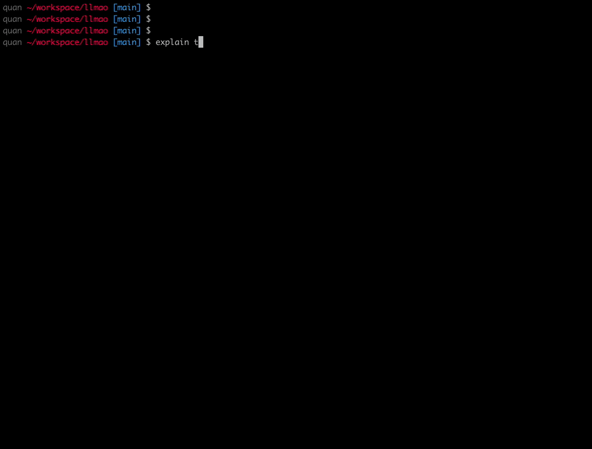

# llmao

I keep typing plain English in my shell prompt instead of inside a coding agent.

```text
$ explain what this project is about
zsh: command not found: explain
```

With **llmao**, natural language text automatically opens my coding agent of choice.



Supports all [major coding agents](#supported-agents) on **zsh**, **Bash 4+**, and **Fish 3.6+**.

## Install

**Homebrew (macOS)**

```sh
brew install mquan/tap/llmao
```

Add the printed `source` line to your shell config.

**Standalone install with automatic activation**

```sh
curl -fsSL https://github.com/mquan/llmao/releases/latest/download/install.sh | sh -s -- --activate
```

Open a new shell after installation.

## How it works

- **The shell goes first.** llmao kicks in only when your interactive shell can’t find a command. Commands like `git status` run as usual.
- **Likely typos stay in the shell.** Type `gti status` and llmao suggests `git` if it’s the only match. If several commands match, you get the usual shell error.
- **Everything runs locally.** A line like `explain this project` can open your agent in the same terminal, using your current folder. Your shell still handles lines that use syntax like `|`, `>`, or `*.py`.
- **Coding agent selection.** If you have one supported agent installed, llmao uses it automatically. If you have several, choose one or enable launch history to pick the agent you launched most often in your last 10 recognized launches. Ties go to the most recent launch. See [Configure](#configure).

## Configure

```sh
llmao config                     # Show saved preferences
llmao config agent codex         # Always use Codex
llmao config agent auto          # Use automatic selection
llmao config launch-history on   # Use recent launches in auto mode
```

Run `llmao --help` for all settings. Changes apply immediately.

Install and configure your agent separately. If llmao can’t select an installed agent, it falls back to your shell’s missing-command handler.

### Supported agents

| Coding agent | `llmao config agent` value |
| --- | --- |
| Amp | `amp` |
| Antigravity CLI | `agy` |
| Auggie CLI | `auggie` |
| Claude Code | `claude` |
| Cline CLI | `cline` |
| Codex | `codex` |
| Cursor CLI | `cursor-agent` |
| Devin CLI | `devin` |
| Gemini CLI | `gemini` |
| GitHub Copilot CLI | `copilot` |
| Goose | `goose` |
| Kiro CLI | `kiro-cli` |
| OpenCode | `opencode` |
| Pi | `pi` |
| Qwen Code | `qwen` |

Launch history counts recognized start commands in your shell history, such as `opencode` or `kiro-cli chat`. Fish merges repeated identical commands into a single history entry, so those repeats count once.

## Development

```sh
zsh tests/classifier.zsh
python3 tests/integration.py
```

The first command tests classification. The second uses a pseudo-terminal and agent stubs to check launches, terminal input, Ctrl-C, and fallbacks. It also tests modern Bash and Fish when installed. Bash and Fish use macOS's built-in `/bin/zsh` for the shared classifier.

To prepare a release, run `./scripts/package-release OWNER v0.3.0 OUTPUT_DIRECTORY`. Upload the versioned archive and generated `install.sh` to the matching release of `OWNER/llmao`. Use the generated formula in the tap's `Formula/` directory. The installer and formula both use the checksum of the exact archive.

## License

[MIT](LICENSE)
